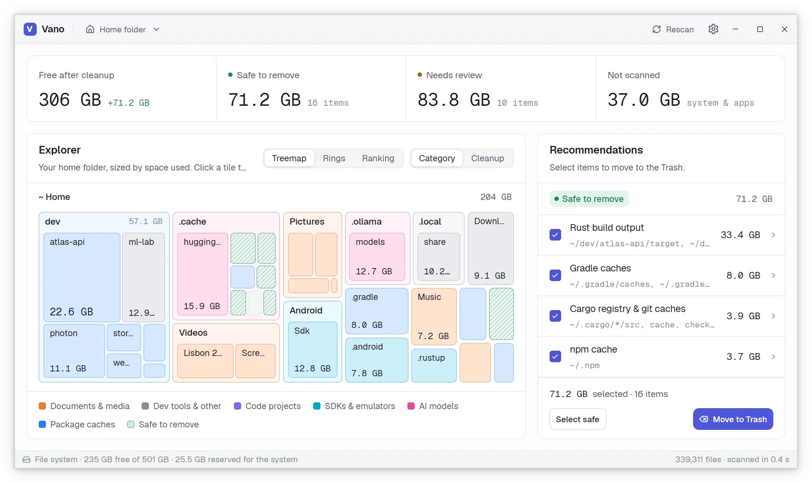

# Vano

Vano (Italian for an empty space, the opening of a door or a window in a wall) is a light,
native, open source disk analyzer. See what fills your disk in an instant and clear it safely:
it shows where the space goes in a treemap you can zoom into folder by folder, and
recommends what can go to the Trash, where everything can still be put back.

[Website](https://vano.tanis.codes) · [Download](https://vano.tanis.codes/install.html) ·
[Documentation](#documentation)

<picture>
  <source media="(prefers-color-scheme: dark)" srcset="site/img/hero-dark.webp">
  
</picture>

> Status: verified on Linux. Windows and macOS builds have not been verified yet.

## Fast and light

- **Instant.** A parallel scanner reads every folder at once: a home folder with 780,000 files
  and 208 GB is scanned in under half a second (warm cache), about 5 times faster than `du`.
- **Light on memory.** About 60 MB of RAM idle, and under 200 MB with those 780,000 files
  loaded. Every file and folder costs 40 bytes in one flat array, so the whole disk fits easily.
- **Quiet.** An idle window does no work: no timers, no animation frames, no CPU while you read
  the results.
- **Native.** Written in Rust, with the UI drawn on the GPU by
  [`gpui`](https://crates.io/crates/gpui), the framework behind the Zed editor. No Electron, no
  web view.

## Goals

- Cross-platform desktop app: Linux, Windows and macOS.
- Scan the home folder, the whole disk or any folder, and watch the result grow live as a
  treemap, rings or a ranking.
- Explore the result as an animated treemap, colored by category (code projects, package caches,
  SDKs and emulators, AI models, media) or by what can be cleaned.
- Recommend what is safe to remove (package caches, build outputs, old installers, idle
  `node_modules`, model weights and more) and what needs a look first, and explain why.
- **Nothing is deleted.** Items go to the system Trash after you confirm, and can be put back.
- **No login, no telemetry, no online sync.** Vano only reads file sizes on your machine, and
  makes an optional update check on macOS and Windows that sends no identifiers.
- Fully open source.

## Building from source

Install Rust with [`rustup`](https://rustup.rs). The toolchain version is pinned in
`rust-toolchain.toml` and installed on the first build. Then install the system dependencies for
your platform:

- **Linux** (Debian and Ubuntu package names):

  ```
  sudo apt install build-essential pkg-config cmake libfontconfig-dev libfreetype-dev \
      libwayland-dev wayland-protocols libxkbcommon-dev libxkbcommon-x11-dev \
      libx11-xcb-dev libxcb1-dev libvulkan-dev
  ```

- **macOS**: Xcode, with its command line tools.
- **Windows**: the Visual Studio Build Tools with the "Desktop development with C++" workload.

Build and run:

```
git clone https://github.com/tanisperez/vano.git
cd vano
cargo run                    # debug build
cargo build --release        # optimized binary in target/release/vano
cargo test --all-targets     # run the tests
```

On Linux and macOS the `Makefile` wraps the usual commands (`make run`, `make release`,
`make test`, `make lint`, ...). Run `make help` for the full list.

## Documentation

Reference documents in this repository:

- [Architecture](AGENTS.md): the crates, the scanner, the treemap and its animation.
- [Design system](docs/design-system.md): colors, type, metrics, screens and motion.
- [gpui notes](docs/gpui-notes.md): theming, dialogs and inputs in gpui.
- [Releasing](docs/releasing.md): how versions are built and published.

## License

Copyright 2026 Estanislao Pérez Nartallo.

Vano is licensed under the [Apache License 2.0](LICENSE). See [NOTICE](NOTICE).
